# Understanding AfterSight from scratch

*A beginner's guide to every idea, file and number in this project, written for viva preparation.*

You need basic Python and the very basics of machine learning. Everything else is explained the first
time it appears. Every number in this guide comes from this repository: saved results, the cached data, or a
script that traced a real building through the real code (`docs/build/understanding_data.py`).

**Contents**

1. [The big picture](#1-the-big-picture)
2. [The basics you need first](#2-the-basics-you-need-first)
3. [Machine learning basics, as used here](#3-machine-learning-basics-as-used-here)
4. [Follow one real building end to end](#4-follow-one-real-building-end-to-end)
5. [Each pipeline stage explained](#5-each-pipeline-stage-explained)
6. [The algorithms, intuitively](#6-the-algorithms-intuitively)
7. [Understanding the results](#7-understanding-the-results)
8. [How the app works](#8-how-the-app-works)
9. [Honest limitations](#9-honest-limitations)
10. [Code map](#10-code-map)
11. [Glossary](#11-glossary)
12. [Test yourself](#12-test-yourself) (answers at the very end)

---

## 1. The big picture

**The problem.** After a hurricane, flood, wildfire or tsunami, rescue and relief teams need to know quickly
**which buildings are damaged and how badly**. Walking street by street takes days and can be dangerous.
Satellites photograph whole cities from above, both before and after the disaster, but nobody can inspect tens
of thousands of roofs by eye.

**What AfterSight does.** For every building in a satellite scene it predicts one of four damage levels:
**no damage, minor damage, major damage or destroyed**. It also shows **why** the model made that prediction.

**Who would use it.** In real life it would be a damage analyst at a relief agency, as a first pass before
sending people to check. In this project the users are us and our examiners: AfterSight is a research and
teaching tool, not an operational system.

**What goes in and what comes out.**

| In | Out |
|---|---|
| a *pre-disaster* satellite image and a *post-disaster* image of the same place, plus the outline of every building | for each building: a damage class, a confidence score, an explanation, and a flag if a human should double-check it |

**An analogy.** Think of an insurance assessor with two photos of a street, one from last year and one from
today. For each house they compare the photos ("the roof was smooth grey, now it is a rough pile of
rubble"), decide a damage level, and write down their reasons. AfterSight does the same with numbers: it
measures colour, roughness and change for each house, and a classical machine-learning model turns those
measurements into a damage level.

**The whole system on one page:**

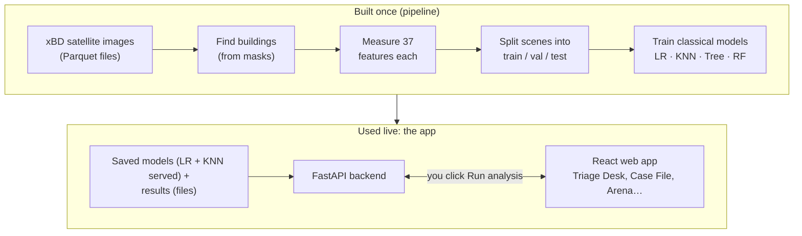

**The one result to remember.** On *new scenes from disasters the models were trained on*, the default model
scores about **0.53** (macro-F1, explained in Section 7). On a disaster it has *never seen*, it scores about
**0.29**. Most of this guide builds up to understanding that gap.

---

## 2. The basics you need first

### 2.1 What a satellite image is

A digital image is a grid of tiny squares called **pixels**. Each pixel stores three numbers between 0 and 255:
how much **red**, **green** and **blue** light it has. These three layers are the image's **channels** (RGB).
0 means none of that colour and 255 means the maximum. A grey roof has roughly equal R, G and B values; grass
has more green.

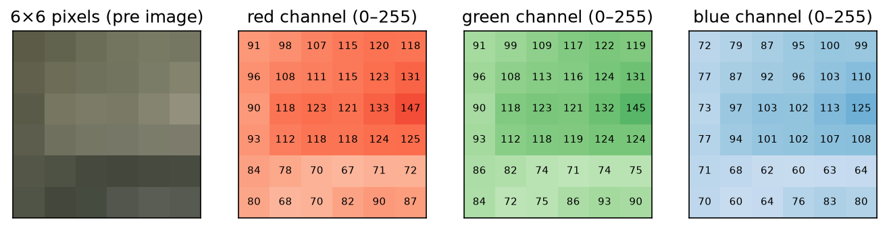

*Figure 1: A 6×6-pixel corner of a real roof (the building we follow in Section 4). The top-left pixel is
R = 91, G = 91, B = 72.*

Every xBD image in this project is **1024 × 1024 pixels**, about a million pixels per image. **Resolution**
says how much ground one pixel covers. The xBD authors chose imagery finer than **0.8 metres per pixel** [1].
At that scale a house is a few dozen pixels across, and fine details (a few missing roof tiles) are close to
invisible.

### 2.2 Pre-disaster and post-disaster images

For each place, xBD gives two photos: **pre** (taken before the disaster) and **post** (taken after). Damage
shows up as *change* between the two. A building that burned down looks dark and smooth before and
grey-white and patchy after. Most of AfterSight's measurements compare pre and post.

### 2.3 What a mask is

A **mask** is an image of the same size where each pixel holds a *label* instead of a colour. Our data has two:

- the **footprint mask** (`t1_mask`): 1 where a building is, 0 elsewhere;
- the **damage mask** (`t2_mask`): 0 for background, then **1 = no damage, 2 = minor, 3 = major,
  4 = destroyed**.

So the damage mask says, pixel by pixel, how damaged the building under that pixel is.

### 2.4 What xBD is and why it was made

**xBD** is a public dataset created for the **xView2** challenge (Gupta et al., 2019 [1]). People annotated
building outlines on pre/post satellite pairs from many disasters (19 in the full dataset). Each building was
graded on the four-level damage scale. It was made because no large, standard dataset existed for training and
comparing damage-assessment methods. It is licensed **CC BY-NC-SA 4.0** (free for non-commercial use with
credit).

Our copy is a **Parquet mirror** of xBD's training split: 17 files, about 8 GB, **2,799 scene pairs** from 10
disasters. **Parquet** is a compressed table file format; here each row holds one scene's two images and two
masks. We use **5 disasters** (Table 1). They were chosen because they contain enough major and destroyed
buildings; some others had almost none.

| Event | Disaster type | Scenes | Buildings | No damage | Minor | Major | Destroyed |
|---|---|---:|---:|---:|---:|---:|---:|
| hurricane-harvey | flooding | 319 | 19,121 | 9,463 | 2,251 | 7,034 | 373 |
| hurricane-matthew | wind | 238 | 9,570 | 2,103 | 4,440 | 1,140 | 1,887 |
| hurricane-michael | wind | 343 | 21,429 | 13,870 | 4,998 | 1,841 | 720 |
| palu-tsunami | tsunami | 113 | 9,157 | 7,360 | 1 | 200 | 1,596 |
| santa-rosa-wildfire | fire | 226 | 12,063 | 8,653 | 76 | 55 | 3,279 |
| **Total** | | **1,239** | **71,340** | **41,449** | **11,766** | **10,270** | **7,855** |

*Table 1: The five events used (from the inspection report and the feature table). "Scenes" counts every cached
scene; 60 of them contain no labelled building, so the splits below cover 1,179 scenes.*

### 2.5 What the four damage classes look like from above

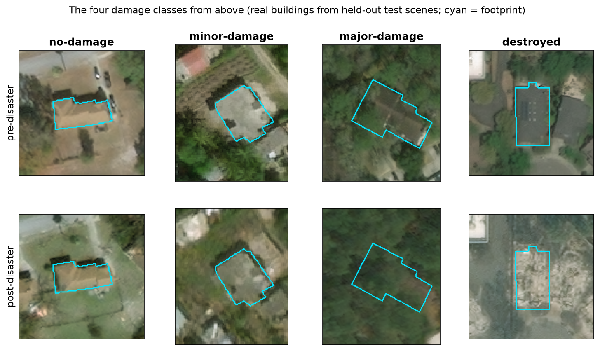

*Figure 2: One real building per class from held-out test scenes (cyan = footprint):
`hurricane-michael_00000009_b0008` (no damage), `hurricane-matthew_00000060_b0016` (minor),
`hurricane-harvey_00000029_b0041` (major), `santa-rosa-wildfire_00000006_b0002` (destroyed).*

Look closely. *No damage* and *destroyed* are obvious. *Minor* and *major* are hard to tell apart even for a
person: the major-damage house is partly hidden by trees and flood-darkened ground. Our models have the same
difficulty.

---

## 3. Machine learning basics, as used here

### 3.1 Features vs labels

- A **feature** is a number that describes an example. Here, one example is one building, and a feature might be
  "how much rougher the roof became" (`gray_std_delta`). Each building gets **37 features**.
- The **label** is the answer we want to predict: the damage class. Labels come from the human annotations
  (the damage mask). We call them **ground truth**.

A **model** learns a rule that maps features to labels from many examples where both are known. It can then
predict the label for a new building from its features alone.

### 3.2 Training, validation and test sets

We split the data into three parts:

- **Training set:** the model learns from it.
- **Validation set:** used to choose settings (**hyperparameters**, such as "how many neighbours should KNN
  use?") by comparing scores.
- **Test set:** used **once, at the end**, to measure how well the final model does on data it has never seen.

Think of it as homework (training), mock exams (validation) and the final exam (test). If you look at the final
exam paper while studying, your mark no longer tells anyone how much you learned. In AfterSight a code object,
`TestSetGuard` (`backend/app/evaluation/metrics.py`), raises an error if any model's test set is evaluated
twice.

**The splits are made per scene, not per building.** Buildings in the same scene share the same photo,
lighting and often the same damage. If neighbouring houses landed in both training and test, the test would
be partly "seen before". So every building of a scene goes to the same split (Figure 3).

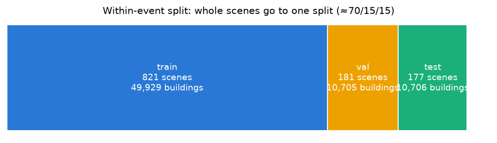

*Figure 3: The within-event split (`data/splits/within_event_v1.json`): 821 training scenes (49,929 buildings),
181 validation scenes (10,705) and 177 test scenes (10,706).*

There is a second split design, **cross-event**. It puts **every hurricane-michael scene that contains buildings (333 scenes, 21,429 buildings) in
test**, and trains on the other four disasters. It answers "how well does this work on a disaster it has never
seen?"

### 3.3 Classification vs clustering

- **Classification** learns from labelled examples to predict a label (supervised learning). Logistic
  Regression, KNN and Decision Trees are classifiers.
- **Clustering** groups examples by similarity **without labels** (unsupervised learning). K-Means is a
  clustering method. We use it only to ask whether buildings naturally fall into damage groups. Its groups
  are never used as predictions.

### 3.4 Overfitting

A model **overfits** when it memorises the training data, noise included, instead of learning general patterns.
It looks great on training data and worse on new data. Examples here:

- A Decision Tree that is allowed to grow very deep can create a leaf for almost every training building. We
  limit its depth (we tried 4, 6, 8 and 12; validation chose 8) and the minimum number of buildings per leaf
  (we tried 20 and 100; validation chose 100).
- KNN with k = 1 would copy the label of the single nearest building, noise included. We tried k = 5, 15 and 31;
  validation chose 15.

### 3.5 Class imbalance

**58% of our buildings are "no damage"** (41,449 of 71,340). A lazy model that always answered "no damage" would
be right 58% of the time and completely useless. That is **class imbalance**. We handle it in two ways:

1. **Balanced class weights:** during training, mistakes on rare classes count more than mistakes on common ones.
2. **Macro-F1** as the main score: it gives each class equal importance (Section 7).

### 3.6 Why classical ML instead of deep learning

**Deep learning** (for example convolutional neural networks, CNNs) learns its own features from raw pixels.
It is the state of the art on xBD, but it needs GPUs, is hard to explain, and is outside our course syllabus.

**Classical ML** uses features that *we* design and models that are simple enough to inspect. Every
AfterSight prediction can be explained: a list of feature contributions, a path of yes/no questions, or the
similar buildings it was compared with. The price is lower accuracy, and we are honest about it.

---

## 4. Follow one real building end to end

We follow **`santa-rosa-wildfire_00000006_b0002`**: a house in a held-out test scene of the 2017 Santa Rosa
wildfire. It is one of the three demo scenes. Every number below was produced by
`docs/build/understanding_data.py`, using the project's own code.

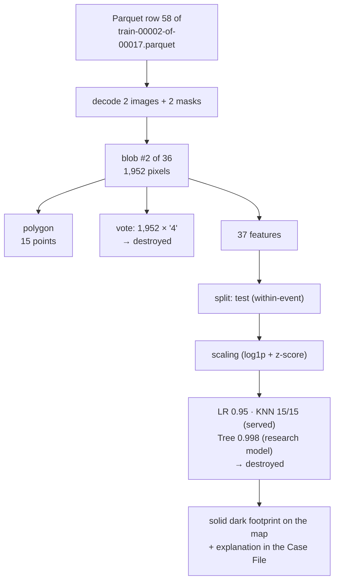

### Step 1: the Parquet row

The scene is stored as **row 58** of `data/raw/xbd_parquet/train-00002-of-00017.parquet`. Its `image_name` is
`train/images/santa-rosa-wildfire_00000006`, which is how we know the event and the scene number. The row holds
four PNG files as raw bytes:

| Column | What it is | Size |
|---|---|---:|
| `t1_image` | pre-disaster photo | 1,495,114 bytes |
| `t2_image` | post-disaster photo | 1,593,407 bytes |
| `t1_mask` | footprint mask | 8,814 bytes |
| `t2_mask` | damage mask | 8,944 bytes |

(Masks are tiny because they are mostly zeros, which compress very well.)

**Code:** `backend/app/datasets/xbd_parquet.py` reads rows a few at a time (`iter_rows`), so the 8 GB of files are
never loaded at once.

### Step 2: decoding the images and masks

Decoding the PNGs gives two **1024 × 1024 RGB** images and two masks. Counting the mask values:

- footprint mask: **902,934** pixels are 0 (background) and **145,642** are 1 (building), so about 14% of
  this scene is buildings;
- damage mask: 0 → 902,969; 1 → 65,338; 2 → 224; 3 → 53,432; **4 → 26,613** pixels.

Only the values 0–4 appear. A full scan of all 2,799 scenes confirmed this: there is no unexpected value.

At the centre of our building, the pre-image pixel is **(98, 103, 97)**, a dark grey roof. The post-image pixel is
**(171, 168, 151)**, much brighter grey-white ash. That brightening is the first hint of what happened.

### Step 3: finding the building blob

The footprint mask is just 0s and 1s. To find *separate* buildings, we look for **connected components**
(blobs): groups of 1-pixels that touch along an edge. This is called 4-connectivity: left, right, up or down,
not diagonally. `scipy.ndimage.label` numbers the blobs in reading order, top-left first. This scene has
**36 blobs**, and all 36 were kept.

Our building is **blob number 2**, which is why its ID ends in `_b0002`. It spans rows 123–184 and columns
859–892, and contains **1,952 pixels**.

**Code:** `backend/app/datasets/mask_buildings.py` → `buildings_from_masks()`.

### Step 4: turning the blob into a polygon

For drawing on screen we need an outline. OpenCV's `findContours` traces the blob's edge into a **polygon** with
**15 points** (the first point is repeated at the end to close the shape), stored as text:
`POLYGON ((872.5 123.5, 872.5 127.5, 871.5 128.5, 859.5 128.5, …))`. Coordinates are **image pixels**
(x across, y down), not map coordinates.

The polygon's area is 1,859 px², slightly less than the 1,952-pixel blob, because the outline runs through the
centres of the edge pixels. For measurements we always use the exact pixel count.

### Step 5: the majority-vote label

We read the damage-mask values under the blob's 1,952 pixels. **All 1,952 are 4**, so the label is
**destroyed**, with a **purity** of 1.0 (100% agreement). If two buildings had been touching, the blob might
mix values (say 140 pixels of "3" and 60 of "2"). The majority would win and the blob would be logged as
*mixed*. Ties, blobs with no damage value and blobs smaller than 16 pixels are dropped, and each drop is
logged with its reason.

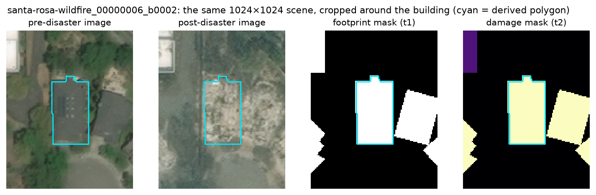

*Figure 4: Our building (cyan outline) in all four layers. In the damage mask, the bright yellow means value 4
(destroyed).*

### Step 6: computing its 37 features

`backend/app/features/extract.py` measures the building's pixels in both images. A sample of the real values:

| Feature | Value | What it means |
|---|---:|---|
| `pre_mean_r` → `post_mean_r` | 89.2 → 155.4 | average red got much higher: the roof turned light grey |
| `abs_dmean_r` | 66.3 | size of that change in red |
| `gray_absdiff_mean` | 60.1 | on average, each pixel's brightness changed by 60 (out of 255) |
| `brightness_ratio` | 1.64 | post is 64% brighter than pre |
| `gray_std_pre` → `gray_std_post` | 11.4 → 23.4 | brightness spread inside the roof doubled: it became patchy |
| `gray_std_delta` | +12.0 | that roughness change |
| `edge_density_pre` → `edge_density_post` | 0.023 → 0.181 | share of roof pixels on an edge (Canny detector) jumped from 2% to 18%: rubble has many edges |
| `glcm_homogeneity_pre` → `_post` | 0.755 → 0.515 | neighbouring pixels became much less alike (texture broke up) |
| `glcm_homogeneity_delta` | −0.240 | that drop |
| `ring_dmean` | +32.1 | the ground around the house also got brighter (ash everywhere) |
| `contrast_change` | +27.5 | the house brightened *more* than its surroundings |
| `area_px` | 1,952 | size in pixels |
| `compactness` | 0.678 | how compact the shape is (1 = circle, 0.785 = square) |

*Table 2: Real feature values for `santa-rosa-wildfire_00000006_b0002`.*

Two terms in the table: the **Canny detector** is a standard algorithm that marks pixels on sharp brightness
edges, and **GLCM** (grey-level co-occurrence matrix) statistics describe texture by counting how often
neighbouring pixels have similar brightness. Homogeneity is 1 when neighbours are identical.

Every sign points to destruction: brighter, rougher, more edges, less uniform. All 37 formulas are in
`docs/FEATURES.md`.

### Step 7: its split

In the **within-event** design this scene is a **test** scene: the models never trained on it. In the
**cross-event** design it is a **training** scene, because only hurricane-michael is held out there. The app
always shows which split a scene belongs to, and warns when a scene was used for training.

### Step 8: scaling

Before the models see the features, the pipeline transforms them using statistics **learned from the training
split only**:

1. **log1p** (log of 1 + x) on the 7 most skewed features, which have a very long tail of large values. For
   example, `area_px` 1,952 → log1p = 7.577.
2. **Standardise** (z-score): subtract the training mean and divide by the training standard deviation, so
   every feature is on a similar scale.

| Feature | Raw | After log1p | Training mean | Training std | z-score |
|---|---:|---:|---:|---:|---:|
| `gray_std_delta` | 12.00 | (not logged) | −0.92 | 10.91 | **+1.18** |
| `glcm_homogeneity_delta` | −0.240 | (not logged) | 0.006 | 0.110 | **−2.23** |
| `gray_absdiff_mean` | 60.09 | 4.112 | 3.234 | 0.466 | **+1.89** |
| `area_px` | 1,952 | 7.577 | 6.783 | 1.032 | **+0.77** |

*Table 3: Real scaling values. A z-score of −2.23 means "2.23 standard deviations below a typical training
building", which is very unusual.*

### Step 9: how each model predicts

**Logistic Regression** (C = 10; C is a setting explained in Section 6.2). It computes a score for each class by multiplying every scaled feature by a
learned weight (a **coefficient**) and adding them up, then turns the scores into probabilities. For
*destroyed*, the biggest pushes were:

| Feature | z-score | Coefficient | Contribution |
|---|---:|---:|---:|
| `gray_std_delta` | +1.18 | +5.57 | **+6.60** |
| `dstd_g` (change in green spread) | +1.15 | −2.74 | −3.15 |
| `post_mean_b` (mean blue, post) | +1.32 | −2.28 | −3.01 |
| `dstd_r` | +1.17 | −2.11 | −2.48 |
| `brightness_ratio` | +2.98 | −0.76 | −2.27 |
| `ring_dmean` | +1.95 | +1.04 | +2.03 |

Negative contributions push *away* from destroyed, but they are outweighed: what matters is the total. The final
*destroyed* score was **3.19** (including the intercept of −0.85 and all the other features). The
probabilities came out as **destroyed 0.951**, minor 0.031, major 0.010, none 0.008.

**KNN** (k = 15). It finds the 15 training buildings whose 37 scaled features are closest to ours. **All 15 are
destroyed buildings**, all from other Santa Rosa scenes (e.g. `santa-rosa-wildfire_00000007_b0047` at distance
1.45). Vote: 15 of 15 → destroyed, confidence 1.0.

**Decision Tree** (depth 8). It asks yes/no questions. The app does not serve the Decision Tree (it serves LR and
KNN), so this path comes from the saved research model; the Model Arena shows the same saved tree. Our building's
path:

1. `glcm_homogeneity_delta` −0.240 ≤ −0.146? **yes**
2. `glcm_homogeneity_post` 0.515 ≤ 0.576? **yes**
3. `area_px` 1,952 > 521? **yes**
4. `glcm_homogeneity_delta` −0.240 ≤ −0.194? **yes**
5. `brightness_ratio` 1.64 > 0.98? **yes**
6. `post_mean_r` 155.4 > 127.8? **yes**
7. `ring_dmean` 32.1 > 5.7? **yes**
8. `contrast_change` 27.5 > −6.2? **yes** → a leaf of **971 training buildings**, almost all destroyed (0.998)

The saved **Random Forest** (not served or shown in the app) also says destroyed (0.997).

### Step 10: the confidence

The **confidence** is the highest class score. What it means depends on the model:

- LR: a probability, though not *calibrated*, meaning nobody checked that predictions at 0.9 are right 90% of
  the time (0.951);
- KNN: the share of neighbours voting for the class (1.0);
- Tree (research model): the class share in the leaf (0.998).

Each served model has a **review threshold** chosen on validation: LR 0.484 and KNN 0.533 (the saved file also
holds Tree 0.526 from when the Tree was served; the app no longer reads it). Our building's confidence is well
above all of them, so it is **not** flagged for human review.

### Step 11: how it appears on the map

When you click **Run analysis** on the Triage Desk with LR, the API returns this building as
`predicted: destroyed, confidence: 0.951, needs_review: false`, cached as analysis `068527454bebc6bf`. The
browser draws its polygon over the satellite image with the *destroyed* style: the **darkest plum, solid
fill**. Each class has its own pattern (outline, dots, hatch, solid), so you can tell them apart without relying
on colour. In "Correct vs wrong" mode it gets a thin solid green outline, because the prediction matches the
ground truth.

For the whole scene, LR got **31 of 36** buildings right (accuracy 0.861, scene macro-F1 0.735).

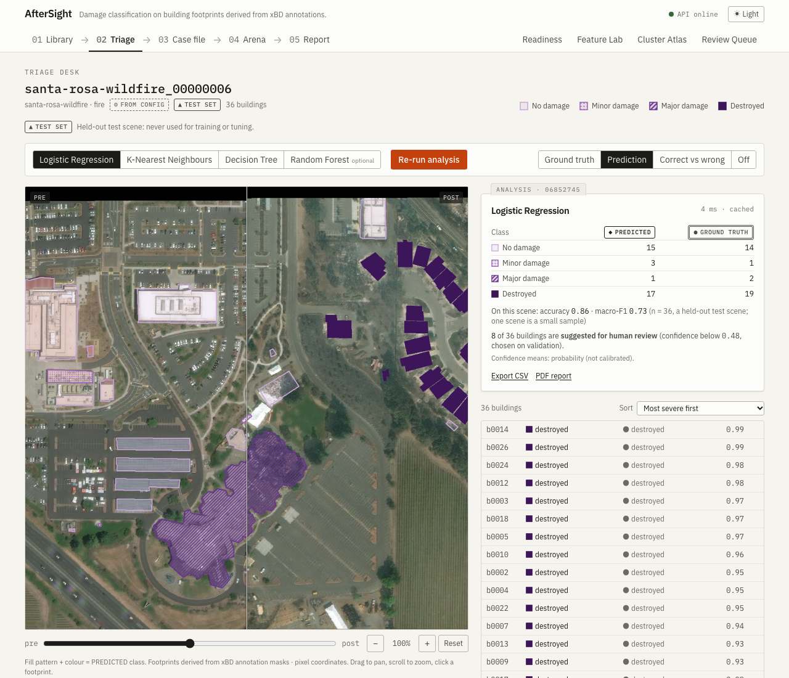

*Figure 5: Triage Desk on `santa-rosa-wildfire_00000006` with LR predictions.*

### Step 12: how the Case File explains it

Clicking the footprint opens its **Case File**. It shows:

- the pre and post crops with the outline;
- *predicted: destroyed* vs *ground truth: destroyed* (✓ agrees);
- the class scores;
- the LR contribution bars from Step 9.

With KNN selected, it shows the 15 neighbour thumbnails instead. The app does not serve the Tree, so the Case
File does not show its 8 questions; they are in Step 9, and the Model Arena shows the saved tree.

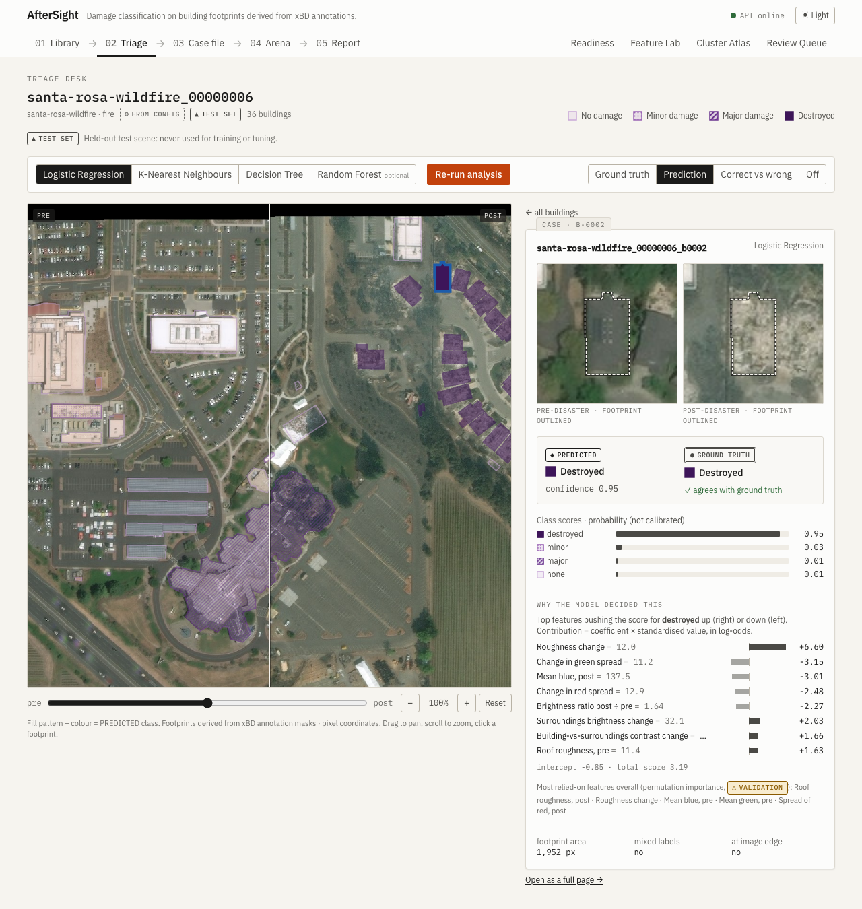

*Figure 6: The real Case File for this building.*

---

## 5. Each pipeline stage explained

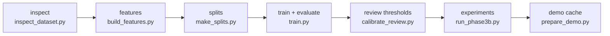

`scripts/run_pipeline.sh` runs all of them in this order. A fresh run took 571 seconds on our laptop.

**Loading** (`backend/app/datasets/xbd_parquet.py`)
- **Does:** streams Parquet rows, decodes PNG bytes, and reads the event and scene from `image_name`.
- **Why:** the data is 8 GB, more than is sensible to hold in memory.
- **In → out:** 17 Parquet files → one row at a time (images and masks).
- **Mistake avoided:** running out of memory. Peak memory stayed around 1.2 GB.

**Inspecting** (`scripts/inspect_dataset.py`, `backend/app/datasets/inspection.py`)
- **Does:** checks every scene, counts classes per event, checks mask values, measures footprint sizes, and
  flags misaligned pre/post pairs.
- **Why:** before building on data, prove what is actually in it.
- **In → out:** shards → `artifacts/inspection/xbd/inspection_report.json`, CSV files and figures.
- **Mistake avoided:** assuming the data format. This is how we found that the mirror has masks, not polygons,
  and that two events had almost no damaged buildings.

**Building extraction** (`backend/app/datasets/mask_buildings.py`, `backend/app/datasets/scene_cache.py`)
- **Does:** connected components → buildings, majority-vote labels, polygons; caches the 5 selected events
  per scene.
- **Why:** the models need one example per building, and the app needs outlines.
- **In → out:** masks → `data/processed/scenes/<scene_id>/scene.json`, plus the images.
- **Mistake avoided:** silently giving a class to unlabelled buildings. 1,396 blobs with no damage value
  were excluded and counted instead.

**Features** (`backend/app/features/extract.py`, `backend/app/features/table.py`)
- **Does:** computes 37 numbers per building.
- **Why:** classical models need numbers, not images.
- **In → out:** scene cache → `data/processed/features/features_v1.parquet` (71,340 rows, 22.8 MB).
- **Mistake avoided:** feeding the label or the event into the model by accident. Identifiers are stored
  separately, and a test checks this.

**Splits** (`backend/app/training/splits.py`)
- **Does:** assigns whole scenes to train, validation or test, for both designs.
- **Why:** to get honest scores.
- **In → out:** feature table → `data/splits/within_event_v1.json` and `cross_event_v1.json`.
- **Mistake avoided:** leakage, i.e. the same scene in two splits. It is checked automatically before saving.

**Training** (`backend/app/training/run.py`, `backend/app/training/models.py`)
- **Does:** builds each pipeline (log1p → impute → scale → model), tries every setting in a small grid, keeps
  the best on validation, and saves it.
- **Why:** to find good settings without touching test.
- **In → out:** features + split → `artifacts/models/<design>/<scheme>/<model>.joblib` + metadata JSON.
- **Mistake avoided:** **data leakage through preprocessing**. Scaling statistics are learned from training data
  only, inside the pipeline.

**Evaluation** (`backend/app/evaluation/metrics.py`, `backend/app/evaluation/analysis.py`)
- **Does:** computes metrics on test once per model, plus per-event scores, the confounding check and K-Means.
- **Why:** to measure, and to explain the measurement.
- **In → out:** model + test data → `artifacts/metrics/…/comparison.json`, confusion-matrix figures.
- **Mistake avoided:** evaluating test repeatedly until a number looks good. `TestSetGuard` forbids it.

**API** (`backend/app/api/routes.py`, `backend/app/core/store.py`, `backend/app/inference/*`)
- **Does:** 25 web endpoints that serve scenes, images, analyses, explanations and reports from the saved files.
- **Why:** the browser cannot run Python models itself.
- **In → out:** HTTP requests → JSON, JPEG, CSV or PDF.
- **Mistake avoided:** letting a request read any file (path traversal). Only known IDs are accepted, never
  file paths.

**Frontend** (`frontend/src/pages/*`, `frontend/src/viewer/SceneViewer.tsx`)
- **Does:** the web pages.
- **Why:** to make the results explorable and understandable.
- **In → out:** API responses → screens.
- **Mistake avoided:** showing numbers that don't come from data. Every number on screen comes from an API
  response, and tests check this.

---

## 6. The algorithms, intuitively

### 6.1 The threshold baseline (not machine learning)

**Idea.** Take a single feature and cut it into four ranges with three thresholds. Each range is one class.
It's like grading exams by one question: below 40 is "fail", 40–60 "pass", and so on.

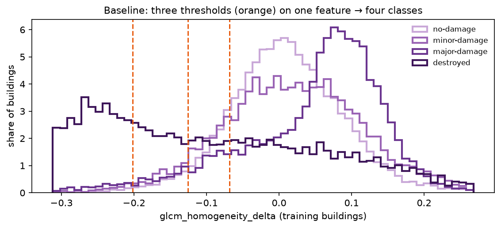

*Figure 7: The chosen feature, `glcm_homogeneity_delta`, for training buildings of each class, with the three
learned thresholds at −0.068, −0.126 and −0.202 (orange). The more negative the value, the more severe the
predicted class.*

**Formula.** Flip the sign so that larger means worse: v = −`glcm_homogeneity_delta`. With thresholds
t₁ = 0.068 < t₂ = 0.126 < t₃ = 0.202, the class is the number of thresholds v passes: 0 = no damage,
1 = minor, 2 = major, 3 = destroyed. Our building has v = 0.240, which passes all three, so it is predicted
*destroyed*.

- **Pros:** trivially explainable; a floor that any real model must beat.
- **Cons:** one feature cannot capture everything. Major damage actually *peaks at positive values* in
  Figure 7, so the baseline misses it.
- **Here:** test macro-F1 0.383 within-event and 0.193 cross-event.

### 6.2 Logistic Regression

**Idea.** Give each feature a weight. Multiply, add up, and the class with the highest total wins. Then squash
the totals into probabilities. **Analogy:** a points checklist, where "+5.6 points for each step of extra
roughness, −2.3 for each step of extra brightness ratio…".

**Formula.** For each class *k*: score `z_k = w_k · x + b_k`, then probability
`p_k = e^{z_k} / Σ_j e^{z_j}` (the **softmax** function).

- *x* is the vector of 37 scaled features.
- *w_k* holds the 37 learned weights for class *k*.
- *b_k* is the intercept (bias).
- *e* is Euler's number (≈ 2.718).
- The Σ adds up over all four classes, so the probabilities sum to 1.

With two classes this reduces to the familiar **sigmoid** `1 / (1 + e^{-z})`.

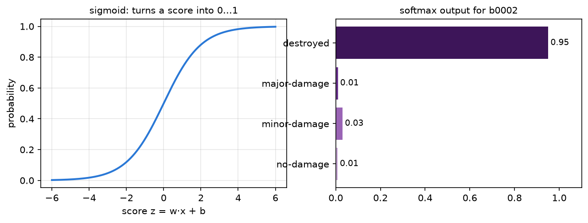

*Figure 8: Left, the sigmoid turns any score into a number between 0 and 1. Right, LR's real output for our
building.*

**C** controls **regularisation**: how strongly the weights are kept small to avoid overfitting. Smaller C means
stronger regularisation. We tried 0.01, 0.1, 1 and 10; validation chose 10.

- **Pros:** fast (training took 1.1 s); weights are directly interpretable; outputs probability-like scores.
- **Cons:** assumes each feature pushes in one direction (linear), so it cannot learn "medium is bad, but low
  and high are fine".
- **Here:** within-event test macro-F1 **0.527**, cross-event **0.290**. It is the app's default model.

### 6.3 K-Nearest Neighbours (KNN)

**Idea.** "Show me the most similar buildings I've already seen, and copy their majority label." **Analogy:**
guessing a house price from the prices of the most similar houses nearby.

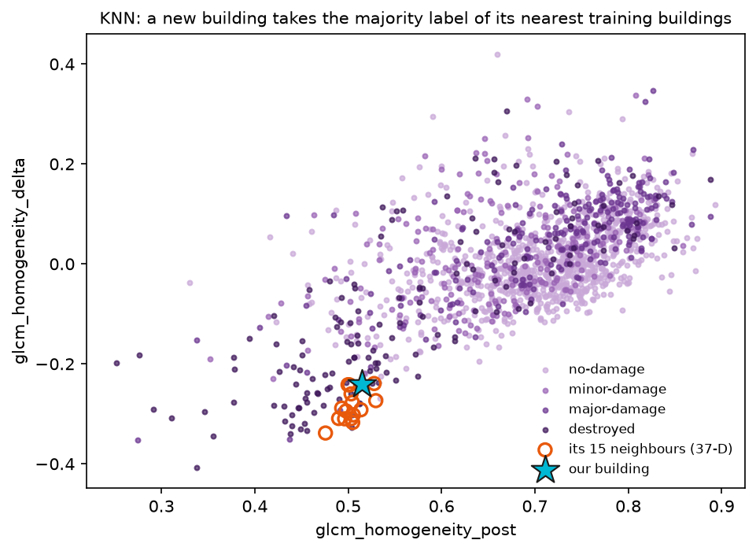

*Figure 9: Training buildings plotted on two of the 37 features. Our building is the star; its 15 real neighbours
(found using all 37 features) are circled.*

**Formula.** Distance between buildings *a* and *b*: `d(a, b) = √( Σᵢ (aᵢ − bᵢ)² )` (Euclidean distance over the
37 scaled features *i*). Pick the *k* smallest distances; the predicted class is the most common label among
them; confidence = votes for that class ÷ *k*.

- **Pros:** no training needed; the explanation is concrete ("these 15 similar buildings were destroyed").
- **Cons:** slow at prediction time, because it compares with all 49,929 training buildings (about 20 ms per
  1,000 buildings, against 0.2 ms for LR). Sensitive to how features are scaled.
- **Here:** k = 15 with uniform votes; test macro-F1 0.520 within-event, 0.271 cross-event.

### 6.4 Decision Tree

**Idea.** A flowchart of yes/no questions, learned from data. **Analogy:** a doctor's triage checklist ("fever
above 38? → yes → rash? → …").

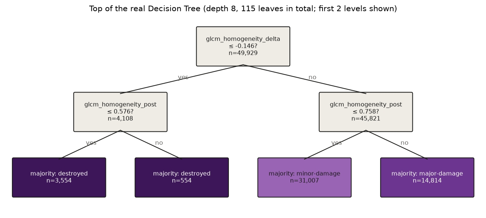

*Figure 10: The first two levels of the real tree. The very first question is about the texture change, the
most informative single split.*

**How a question is chosen.** At each node, the tree tries many feature/threshold pairs and keeps the one that
makes the two groups most "pure", using **Gini impurity**: `G = 1 − Σ_k p_k²`, where *p_k* is the share of class
*k* in the group. G = 0 means every building in the group has the same class.

- **Pros:** completely readable; handles non-linear patterns; no scaling needed in principle.
- **Cons:** a single tree is unstable (small data changes can change the tree) and overfits if grown too deep.
- **Here:** depth 8, at least 100 buildings per leaf, 115 leaves; test macro-F1 0.470 within-event, 0.294
  cross-event (the best cross-event score, by a hair). It is not served in the app; its saved results are the
  research comparison with KNN (the paper's question) and appear in the Model Arena with that label.

**Random Forest** (a saved reference; not served or shown in the app) averages 200 such trees, each grown on a random sample of data and features. It is
more accurate (0.546 within-event) but loses the single readable path.

### 6.5 K-Means (clustering, analysis only)

**Idea.** Choose *k*, place *k* centre points, assign every building to its nearest centre, move each centre to
the average of its buildings, and repeat until nothing changes. **Analogy:** sorting a pile of socks into *k*
heaps by how alike they look, without knowing which pairs belong together.

**Formula.** K-Means minimises the **inertia** `Σ_buildings ‖x − μ_c(x)‖²`: the total squared distance from
each building *x* to the centre *μ* of its cluster *c*. The **silhouette** score (−1 to 1) measures how much
closer each point is to its own cluster than to the next one.

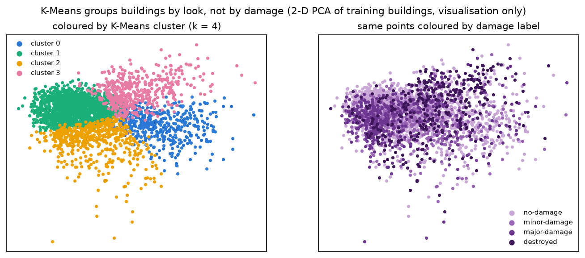

*Figure 11: The same training buildings coloured by K-Means cluster (left) and by true damage (right). The
groups do not line up.*

- **Pros:** simple; shows the natural structure of the data.
- **Cons:** you must choose *k*; clusters have no meaning attached.
- **Here:** the best silhouette is at k = 2 (0.253). Agreement with damage labels is weak: adjusted Rand
  index 0.041 at k = 2 and 0.095 at k = 4.

---

## 7. Understanding the results

### 7.1 Reading a confusion matrix

A **confusion matrix** counts, for every true class (row), how often the model predicted each class (column).
The diagonal holds the correct predictions. Here is LR on the within-event test set (10,706 buildings):

| true ↓ / predicted → | no damage | minor | major | destroyed | total |
|---|---:|---:|---:|---:|---:|
| **no damage** | **3,264** | 779 | 1,757 | 420 | 6,220 |
| **minor** | 363 | **815** | 297 | 293 | 1,768 |
| **major** | 276 | 243 | **871** | 150 | 1,540 |
| **destroyed** | 61 | 90 | 65 | **962** | 1,178 |

*Table 4: Real confusion matrix
(`artifacts/models/within_event/four_class/logistic_regression.json`).*

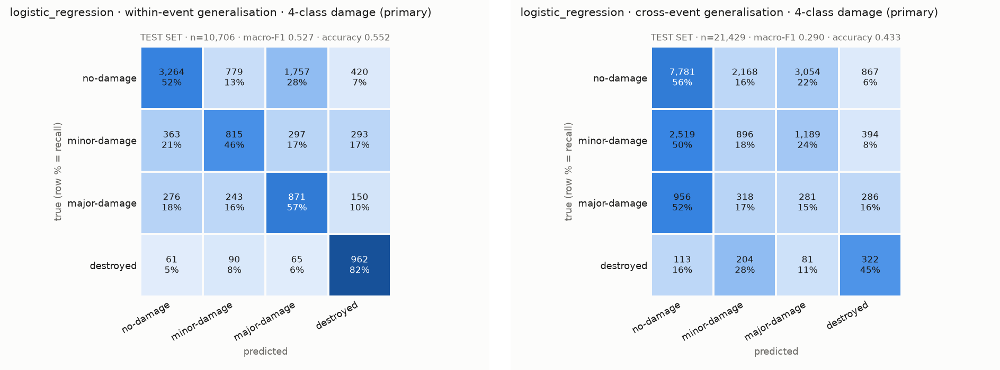

*Figure 12: The same matrix as a heatmap (left) and the cross-event one (right). Row % = recall.*

### 7.2 The metrics, with worked examples from Table 4

- **Accuracy** = correct / all = (3,264 + 815 + 871 + 962) / 10,706 = 5,912 / 10,706 = **0.552**.
- **Precision** for a class: of everything *predicted* as that class, the share that really was. For
  *destroyed*, the column total is 420 + 293 + 150 + 962 = 1,825, so precision = 962 / 1,825 = **0.527**.
- **Recall** for a class: of everything that really *is* that class, the share we caught. For *destroyed*:
  962 / 1,178 = **0.817**.
- **F1** combines the two (harmonic mean): F1 = 2 · P · R / (P + R) = 2 · 0.527 · 0.817 / (0.527 + 0.817) =
  **0.641** for *destroyed*.
- **Macro-F1** is the plain average of the four per-class F1 scores:
  (0.641 + 0.441 + 0.385 + 0.641) / 4 = **0.527**.

Why macro-F1? The lazy "always no damage" model would have accuracy 6,220 / 10,706 = 0.58, *higher* than our
model, but F1 = 0 for three classes, so macro-F1 ≈ 0.18. Macro-F1 cannot be fooled by imbalance.

Two things the matrix shows:

- **1,757 undamaged buildings were predicted as major damage.** This is the cost of balanced class weights,
  which make the model eager to find rare classes. It is why major damage has a low precision (0.291).
- **Destroyed is caught well** (recall 0.817), because rubble changes the texture a lot.

### 7.3 Why 0.53 within-event but 0.29 cross-event

| Model | Within-event macro-F1 | Cross-event macro-F1 |
|---|---:|---:|
| Threshold baseline | 0.383 | 0.193 |
| Logistic Regression | 0.527 | 0.290 |
| KNN | 0.520 | 0.271 |
| Decision Tree (research comparison: not served in the app) | 0.470 | 0.294 |
| Random Forest (saved reference; not served or shown in the app) | 0.546 | 0.291 |

*Table 5: Test results, each model evaluated once (`artifacts/metrics/*/four_class/comparison.json`).*

Within-event, the test scenes come from the *same five disasters* as the training scenes: the same satellite,
season, region and roof styles. Cross-event, hurricane-michael looks different, and its damage mix is
different too (23% minor damage vs 14% in the training events). Every model loses between a third and a half of its score.
**0.53 is an optimistic upper bound; 0.29 is the realistic figure for a new disaster.**

### 7.4 What the confounding check and the feature-set experiments proved

**Confounding check.** We trained a Logistic Regression to predict the **event** (which disaster) from the same
37 features. It was right **82.9%** of the time, against 25.2% for always guessing the most common event. So the
features carry a strong "which disaster is this?" signature. Per-event scores confirm the effect: within-event,
each disaster alone scores *below* the pooled 0.527 (harvey 0.333, matthew 0.333, michael 0.363, palu 0.529,
santa-rosa 0.460). Part of the pooled score comes from recognising the disaster and its typical damage mix.

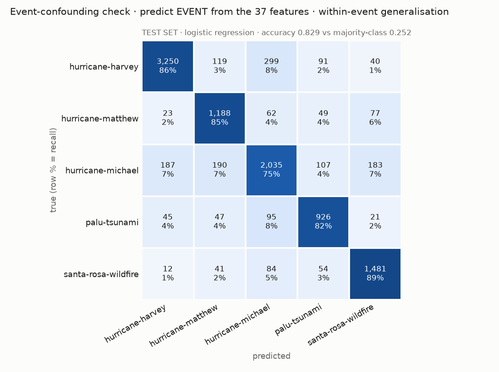

*Figure 13: Predicting the event from the features (test set): most buildings are recognised.*

**Feature-set experiments** (called "Phase 3b" during development, so their files are in `artifacts/experiments/phase3b/` and the script is `scripts/run_phase3b.py`; saved results, no longer shown in the app). We tried to remove that signature:

- **change-only:** 17 features, with no absolute colour levels;
- **scene-normalised:** each feature minus the median of its scene;
- **both combined.**

Event prediction fell from 82.9% to as low as **37.4%**, so the signature shrank. But cross-event macro-F1
**did not improve** (0.236–0.278, against 0.290), and within-event got worse. **Conclusion:** the poor
transfer is not mainly the model "cheating" with the event. It is a genuine **domain shift**: damage
looks different in different disasters, and these hand-made features can't bridge that.

### 7.5 Why K-Means agrees weakly with damage

K-Means groups buildings by whatever differs most in the features: roof colour, vegetation, scene brightness,
which disaster. Damage is only one of many sources of variation, and often not the biggest. The adjusted Rand
index (0 = random agreement, 1 = perfect) is only **0.041–0.095**. That doesn't mean the features are useless:
the supervised models *do* find damage, because they are told what to look for.

---

## 8. How the app works

### 8.1 Frontend ↔ API ↔ saved models

- The **frontend** (React, in your browser) only displays things.
- The **API** (FastAPI, Python, port 8020) loads saved models and data files and answers requests.
- The app serves two models, Logistic Regression (default) and KNN (`serving.models` in
  `config/training.yaml`). The Decision Tree and Random Forest are trained by the pipeline for research but not
  served; asking the API for them gives a clean "Unknown model" error.
- Nothing is trained by the app. Training happens only when you run the pipeline scripts.

### 8.2 What happens when you click "Run analysis"

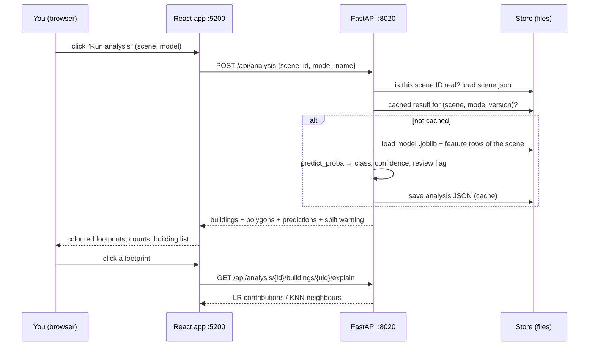

On a typical 40-building test scene this takes **8–22 ms** the first time, and about **3 ms** once cached.

### 8.3 What each page shows and why

| Page | Shows | Why it exists |
|---|---|---|
| **Readiness** | what is built and trained; the 0.527 vs 0.290 headline; served models with their test macro-F1, confidence meaning and review threshold | know at a glance whether the system is ready, and how good it honestly is |
| **Library** | scenes, held-out **test** scenes by default, with ground-truth damage bars | choose a scene; training scenes carry a warning |
| **Triage Desk** | swipe between pre and post, zoom, overlays (ground truth / prediction / correct vs wrong), building list | the main workspace |
| **Case File** | one building: crops, predicted vs true, confidence, explanation | understand a single decision |
| **Arena** | LR, KNN and the threshold baseline under both designs, plus the Decision Tree's saved results labelled "research comparison: not served in the app"; confusion matrices, per-event scores, the tree, confounding | compare models honestly |
| **Feature Lab** | which features separate the classes (training split) | see *why* the models work or fail |
| **Cluster Atlas** | precomputed K-Means for k = 2…10: cluster sizes, silhouette, ARI and which damage classes fall into each cluster; clearly marked "never predictions" | unsupervised view of the data; a cluster ID is not a damage class |
| **Review Queue** | buildings *suggested for human review* (low confidence, or LR and KNN disagree) | where a person should look first |
| **Reports** | CSV and PDF per analysis | take the results away |

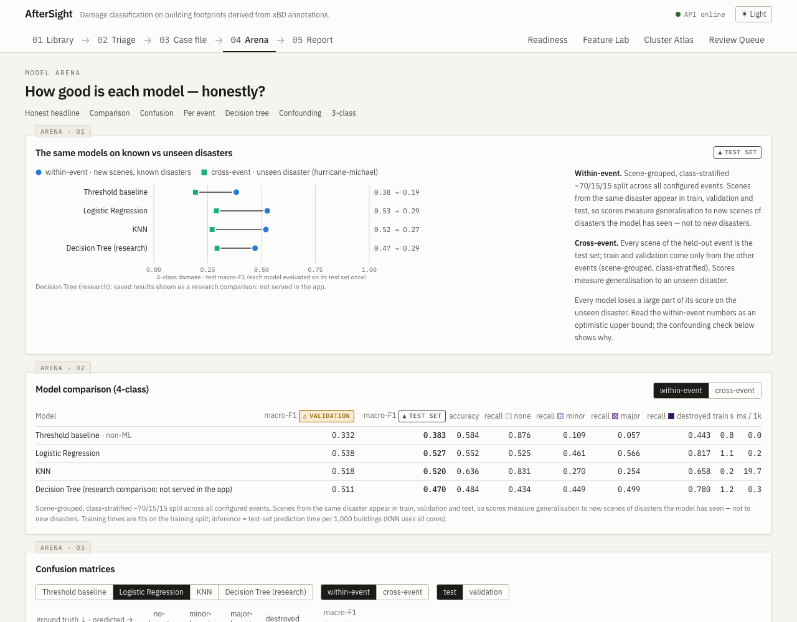

*Figure 14: The Model Arena's first view: every model drops from within-event to cross-event. The Decision Tree
row is the saved research comparison; the app serves LR and KNN.*

---

## 9. Honest limitations

| Limitation | Why it exists |
|---|---|
| Buildings come from **masks**, not original outlines; touching buildings merge into one blob | our copy of xBD (the Parquet mirror) has no polygons; 782 blobs mixed damage values |
| No real-world coordinates or areas | the mirror has no georeferencing, so polygons are in pixels only |
| **Minor vs major** are often confused | the difference is subtle from above at sub-metre resolution (Figure 2) |
| **0.29** on a new disaster | domain shift between disasters (Section 7.4) |
| Confidence is not a calibrated probability | the models' scores were never calibrated; we only use them with validation thresholds |
| Some buildings (1,396 blobs) excluded | they had no damage value in the mask, and we refuse to guess a class |
| Only xBD's training split | the mirror contains only that split; all our test sets are carved out of it |
| Not for real rescue decisions | it is a research and teaching project with known error rates |

---

## 10. Code map

| Path | What it does |
|---|---|
| `scripts/run_pipeline.sh` | runs every build step in order |
| `start.sh` | starts the API (8020) and web app (5200), freeing the ports first |
| `scripts/inspect_dataset.py` | inspects the shards, fills the scene cache |
| `scripts/build_features.py` | builds the 37-feature table |
| `scripts/make_splits.py` | writes the two split manifests |
| `scripts/train.py` | trains, tunes and evaluates every model; K-Means; confounding check |
| `scripts/calibrate_review.py` | chooses review thresholds on validation |
| `scripts/run_phase3b.py` | the feature-variant experiments |
| `scripts/prepare_demo.py` | picks and pre-caches the 3 demo scenes |
| `scripts/e2e_check.py` | end-to-end test on synthetic data |
| `scripts/snapshot_behaviour.py` | proves a refactor changed no prediction, explanation or Feature Lab number |
| `config/events.yaml` | which events, disaster types, mask settings |
| `config/features.yaml` | feature settings (ring width, Canny, GLCM) |
| `config/training.yaml` | splits, model grids, serving models, review target |
| `backend/app/datasets/xbd_parquet.py` | streams the Parquet shards |
| `backend/app/datasets/mask_buildings.py` | masks → buildings, labels, polygons |
| `backend/app/datasets/inspection.py` | the dataset inspector |
| `backend/app/datasets/scene_cache.py` | per-scene cache on disk |
| `backend/app/features/extract.py` | computes the features for one building |
| `backend/app/features/schema.py` | names of the 37 features and the non-feature columns |
| `backend/app/features/table.py` | builds and loads the feature table |
| `backend/app/features/variants.py` | feature-set experiment variants |
| `backend/app/training/splits.py` | scene-grouped splits and leakage checks |
| `backend/app/training/models.py` | pipelines, baseline rule, log1p transformer |
| `backend/app/training/run.py` | tuning, single test evaluation, saving |
| `backend/app/training/persistence.py` | save/load models with compatibility checks |
| `backend/app/evaluation/metrics.py` | metrics and `TestSetGuard` |
| `backend/app/evaluation/analysis.py` | K-Means and the confounding check |
| `backend/app/explain/explain.py` | LR contributions and KNN neighbours (the app); tree paths and the tree structure (the saved research tree) |
| `backend/app/api/routes.py` | all API endpoints |
| `backend/app/core/store.py` | file-based data access, ID validation |
| `backend/app/inference/analysis.py` | runs and caches an analysis; explanations |
| `backend/app/inference/review.py` | review thresholds: calibration on validation, which thresholds are usable, READY / PARTIAL / NOT READY |
| `backend/app/inference/review_queue.py` | builds the review queue |
| `backend/app/experiments/summary.py` | reads and checks the saved feature-set experiment summary for `/results/experiments` (the UI no longer shows it) |
| `backend/app/inference/feature_lab.py` | Feature Lab statistics (η², per-class percentiles, scatter sample), training split only |
| `backend/app/reports/reports.py` | CSV and PDF reports |
| `frontend/src/pages/` | one file per page (Triage Desk, Arena, …) |
| `frontend/src/viewer/SceneViewer.tsx` | the swipe/zoom/overlay viewer |
| `frontend/src/components/CaseFile.tsx` | the Building Case File |
| `frontend/src/charts/` | hand-made SVG charts |
| `frontend/DESIGN.md` | the visual design system |
| `docs/FEATURES.md`, `docs/RESULTS.md`, `docs/ML_EXPLAINED.md`, `docs/API.md`, `docs/VIVA_NOTES.md` | detailed references |
| `docs/SIMPLIFICATION_NOTES.md` | what the v1.1 simplification changed and how behaviour was kept identical |
| `docs/FIXES_V1_2.md` | the v1.2 status, wording and missing-file fixes |
| `docs/CHANGES_V1_3.md` | the v1.3 audit, environment diagnosis and Cluster Atlas changes |
| `backend/tests/`, `frontend/src/**/*.test.tsx` | 148 backend and 37 frontend tests |

---

## 11. Glossary

| Term | Simple meaning |
|---|---|
| **Adjusted Rand index (ARI)** | how similar two groupings are: 1 = identical, 0 = no better than random |
| **API** | a set of web addresses a program can call to get data (here: FastAPI on port 8020) |
| **Balanced class weights** | making mistakes on rare classes count more during training |
| **Baseline** | the simplest reasonable method, used to show that a real model adds value |
| **Blob / connected component** | a group of touching pixels; here, one building |
| **Canny edge detector** | an algorithm that marks pixels on sharp brightness edges |
| **Channel (RGB)** | one colour layer of an image: red, green or blue |
| **Classification** | predicting a category from features, learned from labelled examples |
| **Clustering** | grouping examples by similarity without labels |
| **Coefficient (weight)** | how much a feature pushes a linear model's score up or down |
| **Confidence** | the model's highest class score; its meaning differs per model |
| **Confounding** | when something else (here, which disaster) is mixed up with what you want to measure |
| **Confusion matrix** | a table of true vs predicted classes |
| **Cross-event** | testing on a disaster never seen in training |
| **Domain shift** | when test data looks systematically different from training data |
| **Feature** | a number describing an example |
| **F1 / macro-F1** | combines precision and recall; macro = average over classes, each equal |
| **GLCM** | grey-level co-occurrence matrix: statistics of how neighbouring pixel brightnesses relate (texture) |
| **Ground truth** | the reference labels from human annotation |
| **Hyperparameter** | a setting chosen before training (C, k, depth), tuned on validation |
| **Inertia** | K-Means' total squared distance from points to their cluster centres |
| **Label** | the answer to predict (damage class) |
| **Leakage** | information from test data sneaking into training, which inflates scores |
| **log1p** | log(1 + x); shrinks very large values so a long tail matters less |
| **Mask** | an image whose pixels hold labels instead of colours |
| **Overfitting** | memorising training data instead of learning general patterns |
| **Parquet** | a compressed, column-based table file format |
| **Pipeline** | a fixed chain of preprocessing steps plus a model, fitted together |
| **Polygon** | an outline made of points; here in image pixel coordinates |
| **Precision** | of everything predicted as a class, the share that was right |
| **Purity** | the share of a blob's pixels that agree with its majority label |
| **Recall** | of everything that is a class, the share we found |
| **Regularisation** | keeping a model simple (e.g. small weights) to avoid overfitting |
| **Resolution** | how much ground one pixel covers (xBD: finer than 0.8 m) |
| **Scene** | one 1024 × 1024 pre/post image pair |
| **Silhouette** | how well each point fits its own cluster vs the next (−1 to 1) |
| **Softmax** | turns class scores into probabilities that sum to 1 |
| **Standardise (z-score)** | (value − mean) / standard deviation, using training statistics |
| **Test / validation / training set** | final exam / mock exams / homework |
| **Within-event** | testing on new scenes from the same disasters as training |
| **xBD / xView2** | the public building-damage dataset and the challenge it was made for |

---

## 12. Test yourself

1. What are the four damage classes?
2. What does one pixel of an RGB image store?
3. What is the difference between the footprint mask and the damage mask?
4. Why do we split by scene instead of by building?
5. What is the difference between validation and test data?
6. Our building had 1,952 pixels, all with damage value 4. What is its label, and what is its purity?
7. What does `brightness_ratio = 1.64` mean for our building?
8. Why is `log1p` applied to `area_px`?
9. Why is the scaler fitted only on training data?
10. Why is accuracy misleading on this dataset? Give the number.
11. From Table 4, compute recall for minor damage.
12. Why does major damage have low precision for LR?
13. How does KNN produce a confidence value? What was it for our building?
14. Name one pro and one con of a Decision Tree.
15. What does C control in Logistic Regression, and which value was chosen?
16. Why is K-Means not used for predictions?
17. What does the cross-event design hold out, and why?
18. The event can be predicted from the features with 82.9% accuracy. Why does that matter?
19. The feature-set experiments reduced event prediction to 37.4%. Why didn't that fix cross-event performance?
20. A building appears with a dashed red outline in "Correct vs wrong" mode. What does that mean, and what would
    you check in its Case File?

---

### Answers

1. No damage, minor damage, major damage, destroyed.
2. Three numbers from 0 to 255: red, green and blue intensity.
3. The footprint mask marks *where* buildings are (0/1). The damage mask gives each building pixel a damage
   value (1–4).
4. Buildings in one scene share imagery and damage. Splitting them across train and test leaks information and
   inflates scores.
5. Validation is used to choose settings; test is used once at the end to measure the final model.
6. Destroyed, with purity 1.0 (all pixels agree).
7. After the disaster its pixels are on average 64% brighter than before (ash and rubble).
8. Area has a very long tail (up to 648,034 px). The log shrinks huge values so they don't dominate.
9. Otherwise information from validation and test would leak into training.
10. 58% of buildings are undamaged, so always answering "no damage" gives about 0.58 accuracy while being useless.
11. 815 / 1,768 = 0.461.
12. Balanced weights make it predict major often, and 1,757 undamaged buildings were wrongly predicted as major,
    so only 871 / 2,990 = 0.291 of "major" predictions were right.
13. The share of its *k* neighbours voting for the predicted class: 15 / 15 = 1.0.
14. Pro: readable yes/no rules. Con: unstable and overfits when grown deep.
15. Regularisation strength (smaller C = stronger). Validation chose C = 10.
16. Clusters are formed without labels and don't match damage (ARI 0.04–0.10); they have no damage meaning.
17. All of hurricane-michael (21,429 buildings), to measure performance on a disaster never seen in training.
18. Part of the within-event score may come from recognising the disaster, so 0.53 is optimistic.
19. The difficulty is genuine domain shift: damage looks different across disasters. Removing the signature
    also removed useful information.
20. The prediction disagrees with the ground truth. Check the explanation (which features or neighbours drove
    it), the confidence, whether it is flagged for review, and whether the footprint is a merged blob.

---

**References**

[1] R. Gupta *et al.*, "xBD: A Dataset for Assessing Building Damage from Satellite Imagery," arXiv:1911.09296, 2019.
Other references (Haralick's GLCM, Canny, scikit-learn, Breiman, Rousseeuw, Hubert & Arabie) are listed in
`report/AfterSight_Mini_Project_Report.pdf`.
